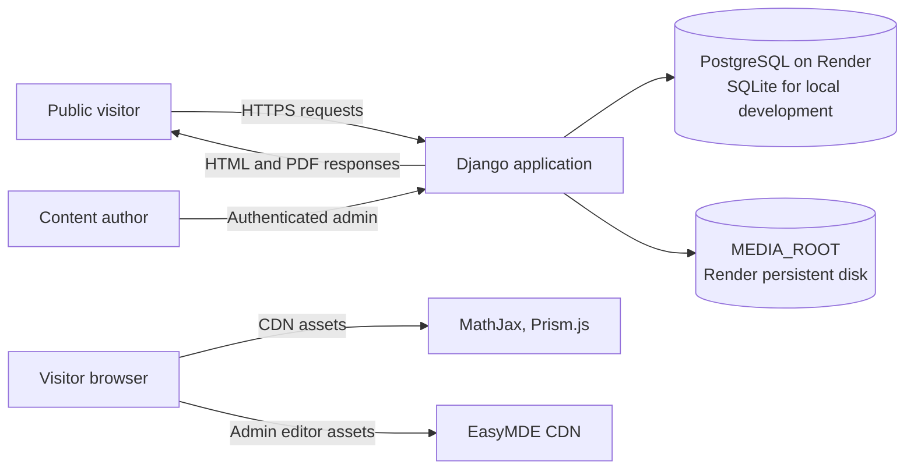
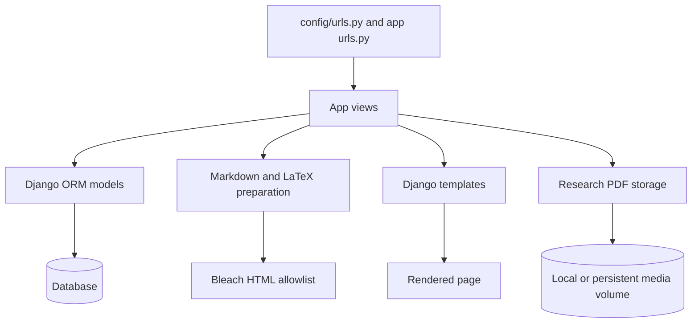
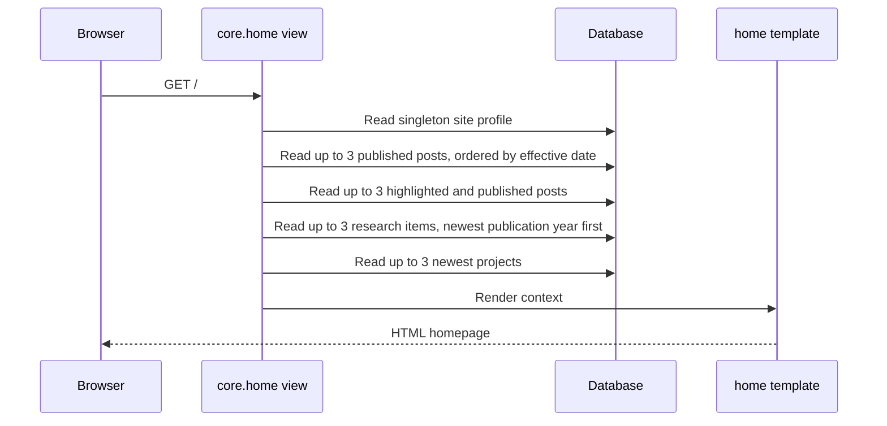
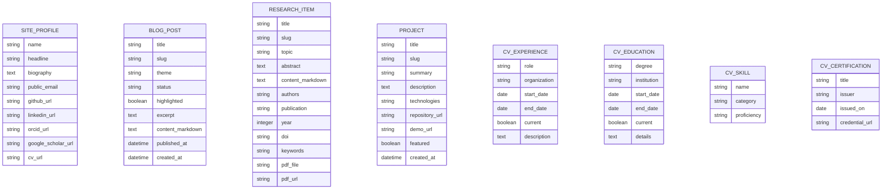
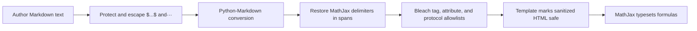

# Portfolio Website — Technical Design

## 1. Purpose and scope

This document describes the current architecture and behavior of the Django portfolio website. It covers the public homepage, blog, research catalogue, project catalogue, Django admin authoring workflows, rendering and security boundaries, and production deployment.

The implementation is server-rendered with Django templates. This document distinguishes implemented behavior from recommendations; recommended work is not implied to exist in the application.

## 2. Product goals

- Present the portfolio owner, biography, contact details, and external profiles.
- Give visitors a concise homepage overview with recent content and selected blog posts.
- Publish categorized blog posts, including mathematical notation.
- Present research metadata, full text, code samples, downloadable papers, and citation exports.
- Present project summaries, technologies, source repositories, and demos.
- Allow content updates through Django admin without editing application code.
- Keep public content readable, responsive, and safe to render.

## 3. System context



The application itself renders HTML and owns access to the database and uploaded media. Client-side libraries enhance editing and presentation:

- **EasyMDE** provides a Markdown editing toolbar and preview in the admin.
- **MathJax** typesets LaTeX delimiters in published blog and research content.
- **Prism.js** highlights fenced code blocks on research detail pages. Code is displayed, not executed.

These browser libraries are currently loaded from CDNs and therefore depend on network availability and the relevant third-party origin.

## 4. Architecture

### 4.1 Application layers



- **Routing:** `config/urls.py` mounts the `core`, `blog`, `research`, `projects`, and `cv` applications.
- **Views:** app views select records, apply publication/filter logic, prepare template context, and return HTML or file responses.
- **Models:** Django models define content and metadata and are persisted through migrations.
- **Templates:** shared and app-specific templates generate server-side HTML.
- **Content formatting:** `blog.formatting.render_post_content` converts Markdown to HTML, preserves math expressions, and sanitizes the result. Blog and research use this shared renderer.
- **Storage:** database fields hold metadata and text; research PDF binaries use Django’s configured media storage.

### 4.2 Technology stack

| Concern | Current implementation |
|---|---|
| Web framework | Django 5.2 |
| Database | SQLite by default for local development; PostgreSQL configured by `DATABASE_URL` |
| Application server | Gunicorn |
| Static files | Django `collectstatic` with WhiteNoise compressed manifest storage |
| Uploaded media | Django `FileSystemStorage`, configured with `MEDIA_ROOT` |
| Markdown rendering | Python-Markdown |
| HTML sanitization | Bleach |
| Admin editor | EasyMDE, loaded from a CDN |
| Formula rendering | MathJax 3, loaded from a CDN |
| Code highlighting | Prism.js, loaded from a CDN on research details |
| CV PDF generation | ReportLab, generated on demand from current database records |

## 5. Public pages and routes

The route names below are the app-level paths mounted by the root URL configuration.

| Page or action | Route | Behavior |
|---|---|---|
| Home | `/` | Profile, highlighted posts, and latest three posts, research items, and projects |
| Blog listing | `/blog/` | All published posts, newest first |
| Blog theme filter | `/blog/?tema=<theme>` | Published posts filtered by one valid theme |
| Blog detail | `/blog/<slug>/` | Published post detail; drafts return 404 |
| Research listing | `/investigacion/` | Research items ordered by publication year |
| Research detail | `/investigacion/<slug>/` | Metadata, abstract, optional formatted full text, and resource links |
| Research PDF | `/investigacion/<slug>/pdf/` | Download uploaded PDF as an attachment |
| Research citation | `/investigacion/<slug>/citation/bibtex/` | Download a `.bib` BibTeX record |
| Research citation | `/investigacion/<slug>/citation/apa/` | Download a plain-text APA-style citation |
| Project listing | `/proyectos/` | All projects; featured projects are ordered ahead of other projects |
| Project detail | `/proyectos/<slug>/` | Summary, technologies, description, source and demo links |
| CV | `/cv/` | Public résumé assembled from the site profile and CV records |
| CV PDF | `/cv/descargar/` | Generate and download a PDF from current CV data |
| Admin | `/admin/` | Authenticated content management using Django admin |

Blog theme values are `life` (Vida cotidiana), `science-opinion` (Opinión sobre ciencia), `mathematics` (Matemáticas), `education` (Educación), and `other` (Otros temas). An invalid `tema` value is ignored and the unfiltered listing is shown.

## 6. Homepage design and behavior

The homepage uses the shared `base.html` layout and a warm, light visual theme with cream backgrounds, dark readable text, and the `#EDBA84` accent palette.

### 6.1 Page composition

1. **Global navigation:** links to Blog, Investigación, Proyectos, CV, and Inicio.
2. **Hero:** portfolio owner’s name, headline, biography excerpt, navigation calls to action, and available contact/social links.
3. **Highlighted reading panel:** up to three published posts whose `highlighted` flag is enabled.
4. **Recent-content cards:**
   - Blog: up to three published posts, newest by `published_at`, falling back to `created_at`; each includes its date.
   - Research: up to three entries ordered by publication year descending, with entries missing a year last; each shows its year when present.
   - Projects: up to three newest projects by creation date.

The recent Blog card and highlighted reading panel are independent selections; a post may appear in both. The homepage cards are previews, not pagination controls. “Ver todo” links to each complete section listing.

### 6.2 Homepage request flow



## 7. Content models

### 7.1 Site profile

`core.SiteProfile` contains the owner’s name, headline, biography, top-bar portrait, CV portrait, homepage image, public email, GitHub, LinkedIn, ORCID, Google Scholar, and CV URLs. Its `save()` method forces the primary key to `1`, enforcing a single profile record at the model level. Images are managed through Django admin and served through application views backed by configured media storage.

### 7.2 CV records

The `cv` application provides a singleton `CVProfile` for the editable professional summary, plus independently editable professional and teaching `Experience`, `Education`, `Skill`, `Certification`, and `ResearchProduct` records. Experiences include an employment dedication type (full-time, part-time, hourly teaching, services contract, freelance, internship, or other). Each record has an explicit display order; dated entries are ordered newest first, with current roles or studies first. Skills are grouped into technical, language, and other categories. Research products include type, authors, venue, year, identifier, URL, and description. There are no foreign-key relationships to the site profile because the site has one owner and profile context is shared at render time.

### 7.3 Blog post

`blog.Post` stores:

- Title and unique slug.
- Optional excerpt and Markdown source content.
- One primary theme.
- Draft or published status.
- A homepage-highlighted Boolean.
- Creation, update, and optional publication timestamps.

Public list and detail views include only `published` posts. Posts default to draft. The theme defaults to “Otros temas” to keep existing posts valid when the theme field is introduced. The Blog list is not currently paginated.

### 7.4 Research item

`research.ResearchItem` stores:

- Title, slug, and subject topic.
- Required abstract and optional Markdown full-text content.
- Authors, publication name, and optional publication year.
- Optional publication URL and DOI.
- Optional comma-separated keywords.
- Optional uploaded PDF and optional external PDF URL.
- Creation timestamp.

Uploaded PDFs are checked for a `.pdf` filename extension and the `%PDF-` file signature when model validation runs. This is a basic format check, not a malware scan or a complete PDF validity guarantee.

### 7.5 Project

`projects.Project` stores:

- Title and slug.
- Short summary and full description.
- Optional technologies, source repository URL, and demo URL.
- A `featured` flag and creation timestamp.

The homepage currently selects the newest projects regardless of `featured`; the full project list uses model ordering, which prioritizes featured projects and then recent creation date.

### 7.6 Entity relationships

The current content model is intentionally simple: records are independent and related to each other by links/URLs rather than database foreign keys.



## 8. Authoring workflows

### 8.1 Blog authoring

1. An authorized user opens **Blog → Posts** in Django admin.
2. The author enters title, slug, excerpt, Markdown content, theme, status, and optional publication date.
3. The EasyMDE editor supplies formatting controls, preview, side-by-side mode, and fullscreen mode.
4. The author may mark the post as `Destacada`.
5. Drafts remain hidden from public blog routes. Published highlighted posts may appear in the homepage highlight panel.
6. The author selects one primary theme; visitors filter the public listing with theme buttons.

LaTeX conventions:

- Inline formula: `$x^2$`
- Display formula: `$$ ... $$` on separate lines

### 8.2 Research authoring

1. An authorized user opens **Research → Trabajos de investigación** in Django admin.
2. The author fills bibliographic metadata, abstract, optional full-text Markdown, keywords, DOI/publication URL, and optional PDF upload or external PDF URL.
3. The content field uses the same EasyMDE widget and the shared Markdown/LaTeX rendering pipeline as blog posts.
4. Fenced code blocks such as ```` ```python ... ``` ```` are displayed as code and enhanced by Prism.js; server-side code execution is not part of the workflow.
5. The public research detail page exposes available publication links, PDF links, BibTeX, and APA-style text.

### 8.3 Project authoring

An authorized user enters the project title, summary, full description, technologies, repository/demo URLs, and the featured flag. Featured status affects project-list ordering; homepage selection is based on recency.

### 8.4 CV authoring

An authorized user edits the CV photo in the site profile and the professional summary in the CV profile, then creates, edits, orders, or removes professional experience, teaching experience, education, skills, certifications, and research products from the corresponding Django admin sections. The public CV page and downloadable PDF read the same current database records; the PDF is generated on request and is not stored as a stale uploaded artifact.

## 9. Content rendering and safety

### 9.1 Markdown and math pipeline



`blog.formatting.render_post_content` performs the shared conversion. It enables fenced code, tables, sane lists, and line breaks. Math source is HTML-escaped before insertion into the restored math spans. Bleach sanitizes the final rendered HTML; only the resulting sanitized string is marked safe in the relevant templates.

The allowed HTML is deliberately limited. New Markdown extensions that generate additional HTML tags or attributes must be accompanied by an explicit sanitizer allowlist change and security tests.

### 9.2 Research code blocks

Code comes from Markdown fenced code blocks and is rendered inside `<pre><code>`. Prism.js applies client-side highlighting using the code language class. It is presentation-only: no code is evaluated by Django or by the page.

### 9.3 File downloads

The research PDF view resolves a research record by slug, verifies that an uploaded file exists in configured storage, and streams it through Django `FileResponse` with attachment disposition and an application-generated filename. External PDF links are opened directly from the research detail page.

The CV PDF endpoint builds an A4 document with ReportLab from the profile and CV querysets and returns it with attachment disposition. Text is escaped before it is passed to ReportLab paragraph markup.

## 10. Security and privacy considerations

- Public blog queries explicitly filter by published status; detail lookup also enforces that status.
- Django admin authentication and permissions protect content management routes.
- Rendered Markdown is sanitized with Bleach before it reaches `|safe` template output.
- External URLs are stored in URL fields; links opening new tabs use `rel="noopener noreferrer"` where implemented.
- PDF validation checks the extension and file signature. Production uploads should also consider size limits, malware scanning, and stricter document validation if the threat model requires it.
- The configured Render media disk is persistent application storage; PDF uploads will not survive if deployed without an appropriately mounted persistent volume.
- EasyMDE, MathJax, and Prism.js are CDN dependencies. Production hardening should consider pinning/integrity policy, a Content Security Policy compatible with these scripts, or serving vetted assets locally.
- Secrets and production database connection strings are configured through environment variables, not committed settings.
- Do not store private personal data in public profile fields or publish research files without appropriate rights.

## 11. Deployment and operations

The Render blueprint configures a Python web service, PostgreSQL database, Gunicorn process, and a 1 GB persistent disk mounted at `/var/data`; `MEDIA_ROOT` is set to `/var/data/media`. The start command applies database migrations before starting Gunicorn. `build.sh` installs requirements and collects static assets.

Operational requirements:

1. Apply committed migrations during deployment.
2. Verify the selected Render plan supports the configured persistent disk.
3. Monitor disk consumption and define a backup/retention strategy for uploaded research papers.
4. Treat uploaded PDFs as media, not static assets.
5. Verify `DATABASE_URL`, `SECRET_KEY`, `DEBUG=False`, allowed hosts, and proxy/TLS settings in production.
6. Test CDN asset availability and math/code rendering on the deployed hostname.

## 12. Quality attributes

| Attribute | Current approach | Notes |
|---|---|---|
| Maintainability | Separate Django apps by domain; shared content formatter | Templates currently contain most page-specific CSS inline |
| Security | Django ORM, server-side status filters, Bleach sanitization | Expand file-upload and CSP protections as operational needs grow |
| Accessibility | Semantic headings, navigation labels, article/list structures, native anchors | Continue testing keyboard focus, contrast, and screen-reader announcements |
| Performance | Bounded homepage querysets and server-rendered pages | Blog/research/project full lists are currently unpaginated |
| Availability | Render web service and PostgreSQL; persistent media volume | CDN availability affects editing, math, and syntax highlighting |
| Portability | Environment-driven database/media configuration | Local media and Render persistent storage use Django storage APIs |

## 13. Testing strategy

Current Django tests exercise:

- Published post visibility and draft exclusion.
- Blog theme filtering and filter context.
- Markdown formatting, inline/display math preservation, HTML sanitization, and plain-text line breaks.
- Homepage post date ordering and the three-post limit.
- Homepage research year display and three-item ordering.
- Homepage three-project limit.
- Research Markdown, math, and code output.
- Citation endpoints and unsupported citation formats.
- PDF upload validation and attachment downloads.
- CV content rendering and generated PDF downloads.

Recommended extension of the suite:

- Add browser-level tests for EasyMDE initialization, responsive layouts, theme filter state, MathJax output, and Prism highlighting.
- Add production-like storage tests using the same persistent-volume path/configuration as deployment.
- Add tests for pagination/search if those features are introduced.
- Add explicit accessibility checks for keyboard operation, color contrast, and accessible names.

## 14. Known limitations and future work

These items are not currently implemented:

- Pagination and search for the Blog, Research, and Project listings.
- Multiple blog themes per post; the current model supports one primary theme.
- Rich WYSIWYG document editing; EasyMDE edits Markdown source.
- Rich APA citation generation from structured journal/volume/issue/page fields; current APA output is a basic text citation from available fields.
- PDF malware scanning, size policy, and integrity/backup automation.
- Locally hosted or integrity-pinned CDN assets.
- Automated end-to-end visual and accessibility tests.

Potential next steps should be prioritized from actual usage. A practical sequence is pagination/search, structured citation metadata, upload limits and backups, then browser/accessibility coverage.

## 15. Repository map

| Path | Responsibility |
|---|---|
| `config/settings.py` | Django settings, database, static/media paths, and security settings |
| `config/urls.py` | Root route composition |
| `core/` | Singleton owner profile and homepage aggregation |
| `blog/` | Post model, admin, theme filter, public views, Markdown/math renderer, and tests |
| `research/` | Research metadata, admin, detail/download/citation views, and tests |
| `projects/` | Project model, admin, list/detail views, and tests |
| `cv/` | Structured CV models, admin, public page, generated PDF, and tests |
| `templates/base.html` | Shared document structure, navigation, and global palette |
| `templates/core/home.html` | Homepage hero, highlighted content, and latest-content cards |
| `templates/cv/cv_detail.html` | Public résumé page and PDF download action |
| `templates/blog/` | Blog list and detail pages |
| `templates/research/` | Research list and detail pages |
| `templates/projects/` | Project list and detail pages |
| `render.yaml` | Render service, database, persistent disk, and environment configuration |
| `build.sh` | Dependency installation and static asset collection |
| `requirements.txt` | Python runtime dependencies |
